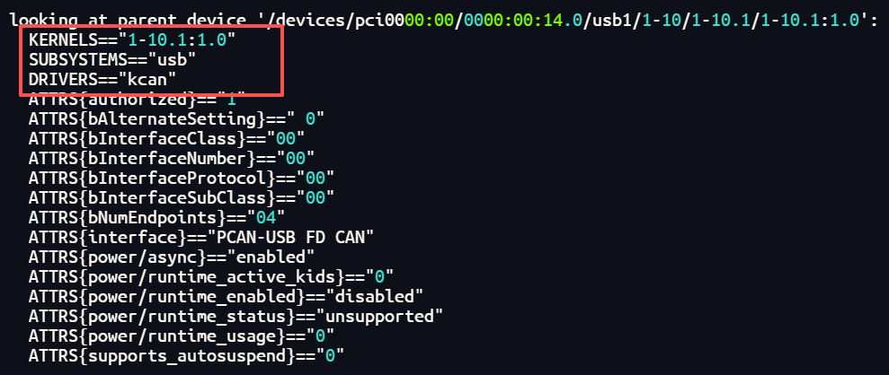

# 通道绑定配置指南

本文档介绍SDK提供的三种通道绑定方式：驱动绑定、USB 绑定和 ID 绑定。

## 目录
- [驱动绑定](#驱动绑定)
- [USB 绑定](#usb-绑定)
- [ID 绑定](#id-绑定)

---

## 驱动绑定

### 概述
通过 build.sh 脚本自动配置加载相应的 udev 规则，使用驱动设备都以kcan命名。

### 操作步骤
1. 执行构建脚本并自动加载 udev 规则：
```bash
sudo ./build.sh -rules
```

2. 编译完成后重新拔插设备。

### 效果验证
绑定成功后的效果如下图所示：        


---

## USB 绑定

### 概述
通过手动设置 udev 规则，根据 USB 端口信息绑定特定的通道名称。

### 操作步骤

#### 1. 获取设备端口信息
使用以下命令获取设备的 USB 端口信息：
```bash
udevadm info -a /sys/class/net/can0
```

输出示例如下图：        


#### 2. 创建 udev 规则文件
创建规则文件：
```bash
sudo vi /etc/udev/rules.d/99_kcan_usb.rules
```

在文件中添加以下内容（根据实际情况修改 KERNELS、NAME 参数）：
```bash
SUBSYSTEM=="net", ACTION=="add", DRIVERS=="kcan", KERNELS=="5-1.3:1.0", NAME="kcan0"
SUBSYSTEM=="net", ACTION=="add", DRIVERS=="kcan", KERNELS=="5-1.4:1.0", NAME="kcan1"
```

#### 3. 重载 udev 规则
```bash
sudo udevadm control --reload-rules
sudo udevadm trigger
```

#### 4. 验证绑定效果
重新拔插设备，绑定效果如下图所示：      


---

## ID 绑定

### 概述
通过设置设备 ID 并配置驱动参数，实现通道绑定。

### 操作步骤

#### 1. 修改 CAN 设备 ID
使用 kcan-settings 工具设置各通道的设备 ID：
```bash
# 设置 can0 通道 ID 为 66
kcan-settings -f=/dev/kcanusbfd32 -d 66

# 设置 can1 通道 ID 为 67
kcan-settings -f=/dev/kcanusbfd33 -d 67

# 继续设置其他通道...
```

#### 2. 确认 ID 设置成功
查看设备 ID：
```bash
kcan-settings -f=/dev/kcanusbfd32 -d
```

#### 3. 修改驱动配置文件
编辑 kcan 驱动配置文件：
```bash
sudo vi /etc/modprobe.d/kcan.conf
```

在文件中添加以下配置参数：
```bash
# 启用基于设备 ID 的分配
options kcan assign=devid
```

#### 4. 重新加载驱动模块
```bash
sudo rmmod kcan
sudo modprobe kcan
```

#### 5. 验证绑定效果
重新拔插设备，ID 绑定效果如下图所示：       

