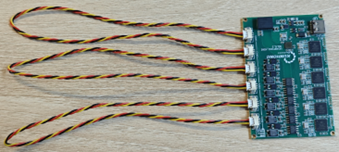
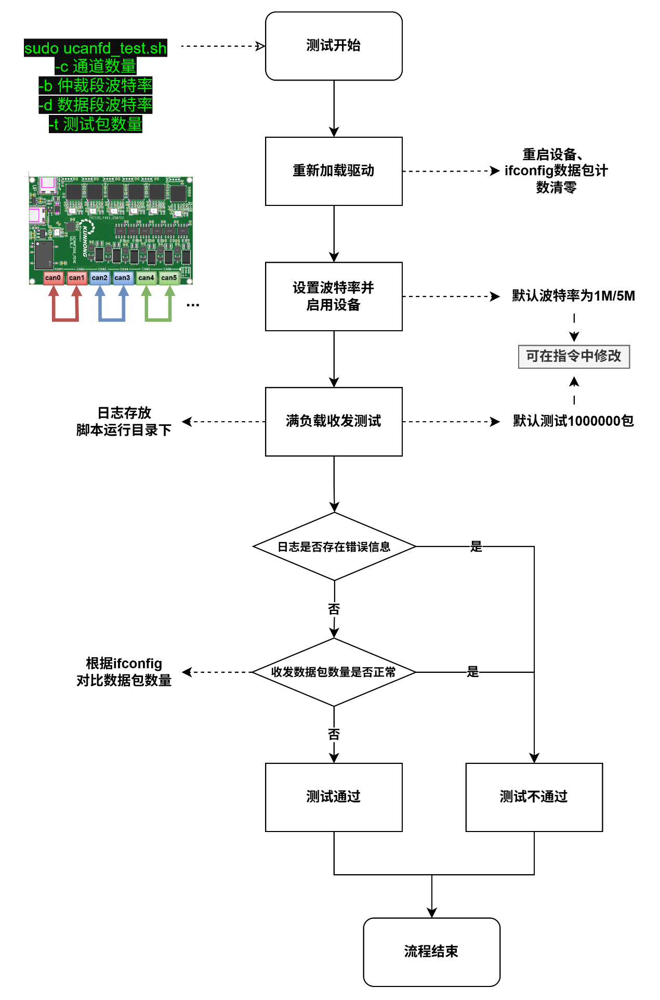
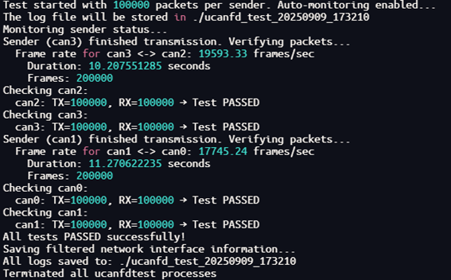
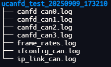

# kcanfdtest测试脚本使用方法  


## 介绍  
在`KH-socket-can-test/`文件夹中提供了若干测试程序/脚本。  
`kcanfd_test.sh`脚本用于测试UCANFD设备在满负载条件下是否能够正常收发数据且不丢包。  
驱动安装完成后，命令行运行`sudo kcanfd_test.sh`，脚本将自动完成驱动加载、参数设置、收发数据包、验证结果等功能。  


## 测试步骤  

### 1. 接线准备  
测试前，需将设备CAN接口按通道顺序两两对接。  
以UCANFDX6为例，接线参考：  
  


### 2. 测试流程  
脚本测试详细流程如下：  
  


### 3. 参数说明  
脚本默认测试6通道和1M/5M波特率，可根据需求修改以下参数：  
- `-c`：通道数（≤12）  
- `-b`：波特率（如500000表示500k）  
- `-d`：数据段波特率（如4000000表示4M）  
- `-t`：测试数据包数量  

**示例**：  
```bash
# 开启can0和can1两个通道，波特率设置1M/5M，测试收发500000数据包
sudo kcanfd_test.sh -c 2 -b 1000000 -d 5000000 -t 500000
```  


### 4. 日志说明  
测试日志默认保存在运行脚本的目录下：  
  

日志内容包含测试详情、帧率及接口收发数据量记录，目录结构示例：  
