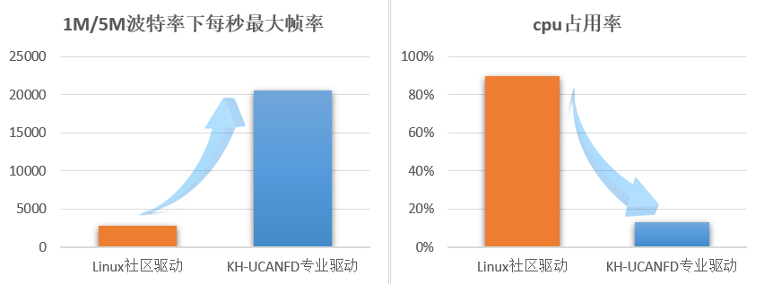
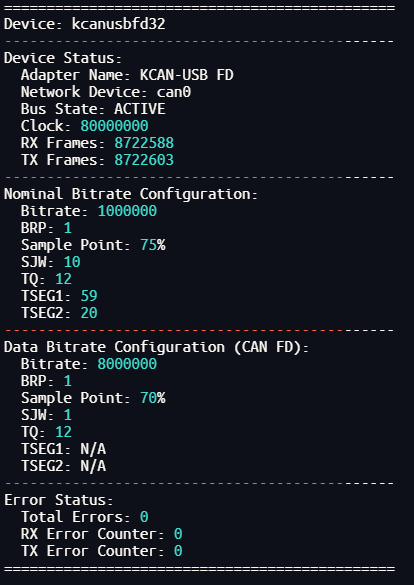
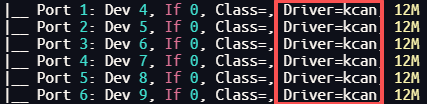
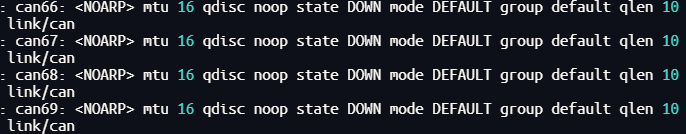
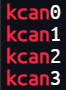

# KH-UCANFD_Linux_SDK

## 目录
- [KH-UCANFD\_Linux\_SDK](#kh-ucanfd_linux_sdk)
  - [目录](#目录)
  - [SDK 介绍](#sdk-介绍)
    - [支持硬件](#支持硬件)
    - [使用场景](#使用场景)
  - [二次开发支持](#二次开发支持)
    - [SocketCAN](#socketcan)
      - [CAN 设备初始化](#can-设备初始化)
      - [can-utils](#can-utils)
      - [SocketCAN编程](#socketcan编程)
    - [python-CAN](#python-can)
  - [实用工具](#实用工具)
    - [lskcan 枚举接口信息](#lskcan-枚举接口信息)
    - [kcan\_monitor 监视器](#kcan_monitor-监视器)
    - [kcanfd\_test 测试脚本](#kcanfd_test-测试脚本)
  - [安装教程](#安装教程)
    - [1. 系统环境需求](#1-系统环境需求)
    - [2. 依赖安装命令](#2-依赖安装命令)
    - [3. SDK下载](#3-sdk下载)
    - [4. 编译与安装](#4-编译与安装)
      - [4.1 脚本自动安装](#41-脚本自动安装)
      - [4.2 手动安装](#42-手动安装)
    - [5. 驱动加载验证](#5-驱动加载验证)
    - [6. 交叉编译](#6-交叉编译)
    - [7. 卸载驱动](#7-卸载驱动)
    - [8. 通道绑定](#8-通道绑定)
  - [常见问题](#常见问题)
  - [达妙电机控制demo](#达妙电机控制demo)
  - [联系支持](#联系支持)

## SDK 介绍
KH-UCANFD_Linux_SDK是专为鲲弘 CAN FD 系列硬件产品设计，提供基于 SocketCAN 标准的深度优化 Linux 驱动及工具，旨在解决 Linux 社区原生驱动性能瓶颈问题，充分释放 CAN FD 设备的吞吐能力并降低 CPU 开销。
- **提供标准SocktCAN接口驱动** 
  - 支持SocktCAN二次开发
  - 支持can-utils, 如cansend，candump等命令
  - 支持python-can
- 源码形式发布,可针对不同目标系统编译/交叉编译
- 支持X86或ARM/ARM64平台
- 支持Linux 内核版本：2.6.x, 3.x，4.x, 5.x, 6.x
- 支持Linux实时扩展，如Xenomai或RTAI(RTDM)

 

### 支持硬件
适配鲲弘 CAN FD 系列硬件设备：
- **KH-UCANFD-Mini 系列产品**（6 通道 CAN FD 接口设备）
- 其他鲲弘 CAN FD 系列兼容设备（参考产品手册确认）

### 使用场景
鲲弘 CAN FD 系列产品均支持Linux 内核自带的SocketCAN驱动
相较于 Linux 系统自带的驱动，KH-UCANFD_Linux SDK有以下特性：
- 同样支持SocktCAN驱动
- 针对硬件进行深度优化，性能显著提升
- 提供转为硬件定制的状态监测工具：lskcan和kcanmoniter

**性能对比**：
关键测试数据（基于 KH-UCANFDX6-Mini + Ubuntu 22.04.3 LTS + 内核 6.8.0）
  | 指标                    | Linux社区驱动    | KH-UCANFD SDK  | 提升效果       |  
  | ----------------------- | ---------------- | -------------- | -------------- |  
  | CAN FD 帧率（1M/5M）    | 2800 帧 / 秒     | 20500 帧 / 秒  | 约**7 倍**提升 |  
  | CAN 总线负载率（1M/5M） | 14%              | 103%（满负载） | 达到极限负载   |  
  | CPU 开销                | 单核心占用超 50% | 无明显占用     | 降低约**85%**  |  

测试数据来源：[KCANFD_Test.md](KCANFD_Test.md)  
  

## 二次开发支持

### SocketCAN
以下为 SocketCAN 开发的基础操作模块，点击链接可进入对应子文档查看详细步骤与说明。

#### CAN 设备初始化
- 设备识别：确认 CAN 设备是否正常挂载、获取设备基础信息（如型号、接口名）
- 设备配置：设置波特率、采样点、工作模式等核心参数，保障总线通信匹配

📚 详细操作指南：[CAN 配置手册](/socketcan/config.md)

#### can-utils
can-utils 是 SocketCAN 官方配套的命令行工具集，提供了 CAN 通信的快速测试与调试能力，常见工具如下表所示。
| 工具命令    | 功能描述                                | 常用参数示例                    |
|------------|-----------------------------------------|-------------------------------|
| cansend    | 发送单条CAN报文                          | `cansend can0 123#112233445566`|
| candump    | 监听并记录CAN报文，可输出到屏幕或文件      | `candump -l -t a can0`         |
| cansniffer |  实时监听CAN报文，按ID分组显示，支持过滤   | `cansniffer -c can0`           |
| canbusload | 统计CAN总线负载率                        | `canbusload can0@500000`       |

📦 工具集完整文档：[can-utils 使用指南](/socketcan/canutils.md)

#### SocketCAN编程
SocketCAN 核心优势在于支持标准 Socket 编程接口，开发者可基于此快速实现 CAN 报文的收发、过滤与异常处理。编程模块将涵盖以下核心内容：
- SocketCAN 套接字创建与初始化（AF_CAN 协议族配置）
- CAN 报文结构解析（标准帧/扩展帧、数据段、ID 等）
- 绑定（bind）、发送（sendto）、接收（recvfrom）核心接口使用
- 报文过滤规则配置与中断处理
- CAN FD 高带宽通信编程实现     
  

💻 编程实践教程：[SocketCAN 编程开发指南](/socketcan/program.md)

### python-CAN

python-CAN 是一个跨平台的 Python 库，提供了简洁的 CAN 通信接口。KH-UCANFD_Linux SDK 完全兼容 python-can，开发者可以使用 Python 快速开发 CAN FD 应用程序。

📚 python-CAN 开发指南：[python-CAN 使用教程](/python-can/README.md)

## 实用工具  
KH-UCANFD_Linux SDK集成kcanfdtest和lskcan等多种工具，用户可以更轻松的使用设备。 
### lskcan 枚举接口信息
lskcan列举CAN接口详细信息:  
``$ lskcan``  
  
列举所有接口的设备状态，以及详细的波特率配置，便于用户检查CAN设备状态。  
### kcan_monitor 监视器
kcan_monitor可实时监测CAN总线状态和CAN传输帧率统计:  
``$ kcan_monitor``  
  
- **dev name**：设备物理标识与通道号  
- **ndev**：Linux 系统中 SocketCAN 子系统分配的网络接口名，如 “can0”“can1”，可通过该名称使用`candump`、`cansend`等标准工具操作。  
- **bits**：CAN FD 波特率配置，格式为 “仲裁段波特率 + 数据段波特率”。  
- **bus**：总线工作状态：  
  - ACTIVE：正常激活状态  
  - PASSIVE：被动状态  
  - BUSOFF：总线关闭状态  
- **%bus**：总线负载率  
- **%tx fifo**：发送缓冲区使用率  
- **rx_fr/s**：每秒接收帧数  
- **tx_fr/s**：每秒发送帧数  
- **rx**：累计接收帧数  
- **tx**：累计发送帧数  
- **rec/tec**：接收错误计数 / 发送错误计数：  
- **err**：累计错误数，包含位错误、填充错误等各类 CAN 总线错误的总计数。  
### kcanfd_test 测试脚本  
kcanfd_test能够测试当前环境下设备的极限负载能力。  
具体使用方法可查看[KCANFD_Test.md](KCANFD_Test.md) 


## 安装教程

### 1. 系统环境需求
1. Linux系统运行32位或64位内核
2. make、gcc编译工具
3. Linux系统的内核头文件包（或Linux头文件包），或交叉编译内核的源码树
4. g++编辑器及libstdc++库
5. libpopt-dev包


### 2. 依赖安装命令
安装驱动前，请先确认系统环境满足以上需求，可执行以下命令安装依赖：
```bash
# 1. 安装编译基础工具
sudo apt update && sudo apt install -y build-essential g++

# 2. 安装内核头文件（必须与当前内核版本匹配）
sudo apt install -y linux-headers-$(uname -r)

# 3. 安装libpopt依赖
sudo apt install -y libpopt-dev

# 4. 验证gcc版本（需与内核编译版本一致，查询方法如下）
cat /boot/config-$(uname -r) | grep -i "gcc_version"
# 示例输出：CONFIG_GCC_VERSION=120300（表示需安装gcc-12）
# 若版本不匹配，安装对应gcc：sudo apt install -y gcc-12
```

### 3. SDK下载
可在releases中手动下载，或使用wget。
```bash
# 安装wget（若未安装）
sudo apt install -y wget

# 下载SDK（最新版本）
wget https://gitee.com/ChengDu-KunHong/KH-UCANFD_Linux_SDK/releases/download/latest/KH-UCANFD_Linux_SDK.zip

# 解压SDK
unzip KH-UCANFD_Linux_SDK.zip

# 进入SDK目录（替换x.y.z为实际版本号）
cd KH-UCANFD_Linux_SDK_x.y.z/
```

### 4. 编译与安装

#### 4.1 脚本自动安装
进入SDK目录后，执行以下命令完成一键安装：
```bash
# 执行编译脚本
./build.sh
```

**build.sh 脚本使用说明：**
```bash
Usage:
  ./build.sh                    安装驱动
  ./build.sh -c                 交叉编译驱动
  ./build.sh -rules             安装驱动并加载udev命名规则
  ./build.sh -u                 卸载驱动
  ./build.sh -uninstall         卸载驱动
  ./build.sh -h                 显示帮助信息
```

#### 4.2 手动安装
执行以下命令完成驱动编译和安装：
```bash
# 清理历史编译文件
sudo make clean

# 编译驱动（若报错，检查依赖是否齐全、gcc版本是否匹配）
sudo make netdev

# 安装驱动（无报错则安装成功）
sudo make install
```

### 5. 驱动加载验证

加载驱动：
```bash
# 加载kcan驱动模块
sudo modprobe kcan

# 验证驱动是否加载成功（输出含"kcan"即正常）
lsmod | grep kcan
```
  
重新拔插 CAN FD 设备后，执行以下命令确认设备被识别：
```bash
# 查看CAN接口信息（输出含"can0"、"can1"等接口即正常）
ip -d link show
```
  
```bash
# 查看USB设备驱动绑定（输出含"Driver=kcan"即正常）
lsusb -t
```
  

### 6. 交叉编译
通过自动编译脚本可以帮助你更简单的完成交叉编译，操作步骤如下：
- 准备交叉编译环境：安装交叉编译工具链、内核源代码等。
- 打开SDK目录下的cross_compile_config.sh，修改相应路径。
```bash
export ARCH=arm64  # 设置目标架构为ARM64
export CROSS_COMPILE=/path/to/your/toolchain/bin/aarch64-linux-gnu-  # 设置交叉编译工具链路径
export KERNEL_LOCATION=/path/to/your/kernel-source/  # 设置内核源代码路径
```
- 执行编译脚本：
```bash
./build.sh -c
```

### 7. 卸载驱动

卸载驱动：
```bash
# 使用脚本卸载
sudo ./build.sh -u

# make 卸载
sudo make uninstall
```
### 8. 通道绑定   
SDK支持通过设备ID、USB以及驱动绑定通道名称。    
设备id绑定     
    
USB以及驱动绑定   


🔧通道绑定详细说明：[通道绑定配置手册](Channel_Binding.md)    

## 常见问题

### Q1：驱动加载时报错 “modprobe: ERROR: could not insert 'kcan': Key was rejected by service”
**原因**：系统启用了 Secure Boot（安全启动），阻止了未签名的第三方驱动加载。  
**解决方案**：进入主板 BIOS/UEFI 设置，关闭 Secure Boot 功能（具体步骤需根据主板型号查询，常见路径：BIOS → Security → Secure Boot → Disabled）。


### Q2：运行`kcanfd_test.sh`测试脚本时丢包或测试失败
**原因 1**：CAN 接口通道未正确对接（脚本需通道两两交叉连接）。  
**解决方案 1**：将设备的 can0 与 can1、can2 与 can3 等通道两两用 CAN 线连接（需接终端电阻，若硬件自带则无需额外添加）。  

**原因 2**：测试参数不匹配设备能力（如通道数超过设备支持上限、波特率配置异常）。  
**解决方案 2**：修改脚本参数（示例：测试 2 通道、500k/4M 波特率、50 万数据包）：
```bash
sudo kcanfd_test.sh -c 2 -b 500000 -d 4000000 -t 500000
```

**补充**：测试日志默认保存在当前目录（如`kcanfd_test_20251028_101329`），可查看日志排查具体错误。  
  

### 若以上方法均无法解决  
运行SDK中的诊断脚本，并将诊断结果发送给我们，操作方式：  
``$ sudo kcanosdiag.sh``  
  
诊断结果保存在当前目录（如`/kcanosdiag-1.0.0-20251105_150505.log`）。  


## 达妙电机控制demo
使用UCANFD_SDK搭配UCANFDX6，通过socketcan控制达妙电机动作。  
  
demo链接：https://gitee.com/ChengDu-KunHong/KH-UCANFD-motor-demo/tree/hoyo/DM  

## 联系支持
若遇到 SDK 安装或使用问题，可通过以下方式获取技术支持：  
- **微信公众号**：搜索 “鲲弘电子 KUNHONG”
- **技术支持邮箱**：support@cdkhdz.com
- **销售咨询**：sales@cdkhdz.com  

  
