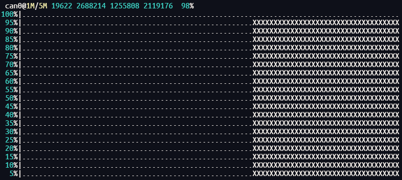
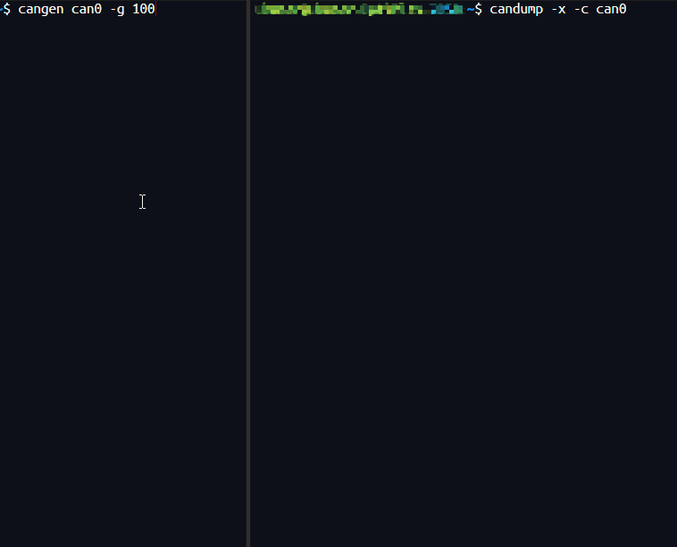

# can-utils
can-utils 工具集涵盖多种实用CAN工具，下面介绍核心工具的典型用法。
安装can-utils工具：
```
sudo apt install can-utils
```
## 常用调试工具
### 报文发送：candump
用于发送单条 CAN 报文，格式为 cansend <接口名> <报文ID>#<数据段>。
```
# 发送标准帧：ID=0x123，数据=11223344
cansend can0 123#11223344

# 发送扩展帧：ID=0x12345678，数据=55667888
cansend can0 X12345678#55667888

# 发送远程帧（仅请求数据，无数据段，前缀加“R”）
cansend can0 R123#

# 发送CAN FD帧（需要接口支持）
cansend can0 123##3112233445566778899AABBCC

# 每100ms发送一次，共发送10次
cansend can0 -l 100 -n 10 123#11223344
```
另外，cansend还支持不同DLC、错误帧等多种报文类型，更多帮助信息。
```
cansend -h
```

### 报文监听：candump
candump实时监听 CAN 总线报文，支持输出到屏幕、保存到文件，核心参数用于过滤 ID、设置时间格式。       
**基本用法**
```
# 监听所有CAN报文
candump can0

# 监听多个接口
candump can0 can1
```

**过滤功能**
```
# 只监听特定ID
candump can0,123:7FF        # 监听ID 0x123
candump can0,100:200        # 监听ID范围 0x100-0x200

# 监听多个特定ID
candump can0,123:7FF,456:7FF,789:7FF

# 使用掩码过滤
candump can0,123:7F0        # 监听ID 0x120-0x12F

# 排除特定ID
candump can0,~123:7FF       # 监听除0x123外的所有ID
```

**输出格式控制**
```
# 彩色输出
candump -c can0

# 显示帧类型
candump -x can0

# 时间格式精细控制
candump -t a -H can0  
```

**日志记录**
```
# 记录到文件
candump -l can0 # 记录到candump-YYYYMMDDHHMMSS.log

# 指定日志文件
candump can0 > can_log.txt
```
更多帮助信息
```
candump -h
```
### 总线负载监控：canbusload
实时刷新显示 CAN 总线的负载率、帧率。       
      
**基本用法**
```
# 显示can0和can1在FD模式1M/5M下的负载率、帧数
canbusload can0@1000000,5000000 can1@1000000,5000000    
```
     
**高级用法**
```
# 打印时间
canbusload -t can0@1000000,5000000
# 可视化界面
canbusload -v can0@1000000,5000000
```
       
更多帮助信息
```
canbusload -h
```

### CAN帧生成工具：cangen
cangen是用于生成和发送 CAN 帧的强大工具，支持多种帧类型和生成模式。
```
# 设置帧发送间隔（毫秒）
cangen -g 100 can0        # 每100ms发送一帧

# 生成扩展帧（29位ID）
cangen -e can0            # 随机29位ID
cangen -e -I 12345678 can0 # 固定扩展ID

# 生成CAN FD帧
cangen -f can0            # 基本CAN FD帧
# CAN FD带比特率切换
cangen -f -b can0         # 启用比特率切换(BRS)
# CAN FD带错误状态指示
cangen -f -E can0         # 设置错误状态(ESI)
```


cangen工具还有很多实用的设置，可查看更多帮助信息。
```
cangen -h
```