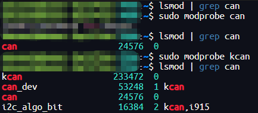
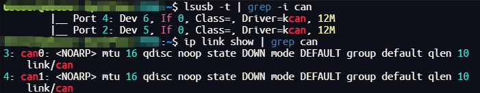
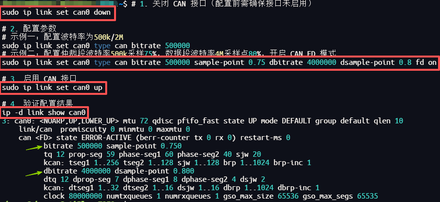

# SocketCAN基础配置
核心概念：
- CAN 接口：Linux 系统中将 CAN 设备映射为网络接口（如 can0、can1），可通过网络命令管理。
- 波特率：CAN 总线通信速率，常见值为 250Kbps、500Kbps、1Mbps，需所有节点保持一致。
- CAN 帧：包含 ID（标识符）、数据段（0-8 字节，CAN FD 支持 0-64 字节）、控制段等，分为标准帧（11 位 ID）和扩展帧（29 位 ID）。

## 环境准备
安装所需的工具：

```
sudo apt install iproute2
```
### 内核支持检查
首先确认内核是否启用SocketCAN模块，可通过`lsmod`命令查看：      
```
# 检查 CAN 核心模块
lsmod | grep can
# 若未加载，手动加载核心模块
sudo modprobe can
sudo modprobe kcan # KH-UCANFD 驱动
```
       

### 设备识别
连接 CAN 设备后，通过以下命令确认设备是否被识别：
```
# 查看 USB 设备（USB-CAN 适配器）
lsusb -t | grep -i can

# 查看网络接口（CAN 设备映射为网络接口）
ip link show | grep can

# 查看详细设备信息
dmesg | grep -i can
```
       

## 设备配置

CAN 设备使用前需配置波特率、工作模式等参数，核心命令如下：
```
# 1. 关闭 CAN 接口（配置前需确保接口未启用）
sudo ip link set can0 down

# 2. 配置参数
# 示例一：配置波特率为500k/2M
sudo ip link set can0 type can bitrate 500000
# 示例二：配置仲裁段波特率500k采样75%，数据段波特率4M采样点80%，开启 CAN FD 模式
sudo ip link set can0 type can bitrate 500000 sample-point 0.75 dbitrate 4000000 dsample-point 0.8 fd on

# 3. 启用 CAN 接口
sudo ip link set can0 up

# 4. 验证配置结果
ip -d link show can0
```
       


## 接口状态
配置完成后，通过ip和ifconfig命令查看接口状态，获取更详细的设备运行信息。        
通过以下命令查看CAN设备的状态、错误计数、数据收发情况等核心信息，是设备调试的重要手段。     
```
# 方法1：ip命令查看设备详细状态（含波特率、错误状态、驱动等）
ip -d link show

# 方法2：ifconfig命令查看收发统计（含包数量、错误数等）
ifconfig -a
```
**ip -d link show 输出示例**
```
can0: <NOARP,UP,LOWER_UP> mtu 72 qdisc pfifo_fast state UP mode DEFAULT group default qlen 10  # can0 CAN FD 模式 启用状态
    link/can  promiscuity 0 minmtu 0 maxmtu 0 
    can <FD> state ERROR-ACTIVE (berr-counter tx 0 rx 0) restart-ms 0 
          bitrate 1000000 sample-point 0.750 
          tq 12 prop-seg 29 phase-seg1 30 phase-seg2 20 sjw 10
          kcan: tseg1 1..256 tseg2 1..128 sjw 1..128 brp 1..1024 brp-inc 1
          dbitrate 8000000 dsample-point 0.700 
          dtq 12 dprop-seg 3 dphase-seg1 3 dphase-seg2 3 dsjw 1
          kcan: dtseg1 1..32 dtseg2 1..16 dsjw 1..16 dbrp 1..1024 dbrp-inc 1
          clock 80000000 numtxqueues 1 numrxqueues 1 gso_max_size 65536 gso_max_segs 65535 
can1: <NOARP> mtu 16 qdisc noop state DOWN mode DEFAULT group default qlen 10 # can1 CAN 2.0B 模式 未启用状态
    link/can  promiscuity 0 minmtu 0 maxmtu 0 
    can state STOPPED (berr-counter tx 0 rx 0) restart-ms 0 
          kcan: tseg1 1..256 tseg2 1..128 sjw 1..128 brp 1..1024 brp-inc 1
          kcan: dtseg1 1..32 dtseg2 1..16 dsjw 1..16 dbrp 1..1024 dbrp-inc 1
          clock 80000000 numtxqueues 1 numrxqueues 1 gso_max_size 65536 gso_max_segs 65535
```
关键状态解读：
- state UP：接口已启用；state DOWN：接口未启用。
- ERROR-ACTIVE：正常工作状态，错误计数器值较低；STOPPED：接口停止工作；若为BUS-OFF则表示总线关闭，无法通信。
- berr-counter tx 0 rx 0：发送/接收错误计数器为0，值越高说明总线干扰越大，超过阈值会触发错误状态。

**ifconfig -a 输出示例及解读**
```
can0: flags=193<UP,RUNNING,NOARP>  mtu 72
        unspec 00-00-00-00-00-00-00-00-00-00-00-00-00-00-00-00  txqueuelen 10  (UNSPEC)
        RX packets 8423  bytes 67384 (67.3 KB)  # 接收数据包数量及字节数
        RX errors 0  dropped 0  overruns 0  frame 0  # 接收错误、丢包等统计
        TX packets 8407  bytes 67256 (67.2 KB)  # 发送数据包数量及字节数
        TX errors 0  dropped 0 overruns 0  carrier 0  collisions 0  # 发送错误、丢包等统计
```

### 错误处理
当CAN设备进入错误状态时，会直接影响通信，需及时排查处理。通过ip -d link show可快速定位错误类型，其中最常见的为BUS-OFF（总线关闭）状态。
```
# BUS-OFF错误状态示例
can <FD> state BUS-OFF (berr-counter tx 248 rx 127) restart-ms 0
```
BUS-OFF状态通常因总线持续存在严重干扰或短路导致，错误计数器达到阈值后设备自动关闭总线。恢复方法如下：
```
# 重启CAN设备以恢复正常状态
sudo ip link set can0 down
sudo ip link set can0 up
```
恢复后重新检查总线连接（如终端电阻是否正常、线材是否破损），避免再次触发错误。